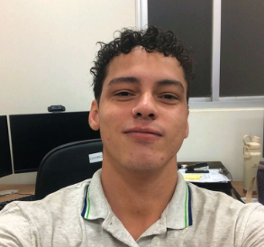

  

<h1 align="center">Glaymar Albuquerque de França</h1>

  <strong>Desenvolvedor web full-stack</strong> 
  Cajazeiras, PB · Aberto a remoto, CLT ou PJ

  Pós-graduação em inteligência artificial 
  Tecnólogo em ADS — IFPB Cajazeiras 
  Fundador da <a href="https://alttabcorp.com.br">AlttabCorp</a>

  <a href="https://bodescorp.github.io/GlaymarAdeFranca/">Portfólio</a>
  ·
  <a href="https://linkedin.com/in/glaymar-albuquerque-de-fran%C3%A7a">LinkedIn</a>
  ·
  <a href="https://wa.me/5583993322427">WhatsApp</a>
  ·
  <a href="mailto:glaymar2010@gmail.com">E-mail</a>

---

### O que faço agora

**Procura.AÍ** — desenvolvedor full-stack bolsista na FAPESQ / LAVID-UFPB (desde out/2024). Construo a aplicação do Governo da Paraíba para autocadastro e recuperação de celulares: backend, API REST e dashboard.

**AlttabCorp** — fundador e desenvolvedor (desde mai/2023). O produto principal é o [YGO / HUB](https://yugiohcz.alttabcorp.com.br/), em produção para a comunidade de Yu-Gi-Oh! de Cajazeiras (Next.js, PostgreSQL, Docker).

**HUJB** — técnico de suporte N1/N2 no Hospital Universitário Júlio Bandeira, pela Life Tecnologia (desde jan/2025).

### Stack

Next.js · TypeScript · React · Node.js · PostgreSQL · Prisma · Redis · Docker · GitHub Actions

No servidor da empresa também uso Ollama, n8n e pgvector quando o projeto pede.

### Formação

Pós em inteligência artificial (Faculdade Alcance, 2026) · ADS no IFPB Cajazeiras (2018–2023, TCC com Neo4j) · Especializações em andamento em arquitetura de software e segurança da informação (FAAL)

---

  
  
  
  
  

